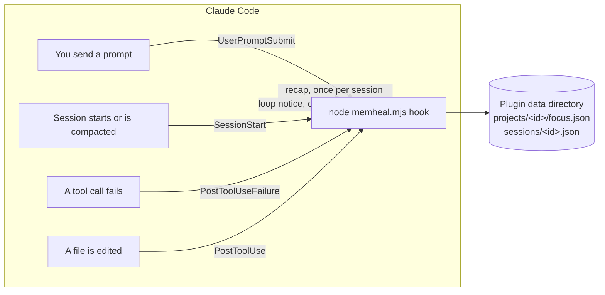

# memheal design

What the plugin does, how, and what was changed on the way from the Go
programs it grew out of. The code is in `plugin/scripts/`, about 850 lines.

## Shape



One program, started by Claude Code with the event as JSON on standard input.
It reads and writes only its own data directory, starts nothing, and calls
nothing over the network. Whatever goes wrong inside a hook, it exits 0 and
prints nothing, so it can never block a prompt.

| File | Job |
|---|---|
| `memheal.mjs` | Entry point: hook dispatch, `status`, `forget` |
| `lib/text.mjs` | Cleaning, redaction, tokenizing, plural stemming, file references |
| `lib/focus.mjs` | Topics from prompts, decay, recap |
| `lib/loops.mjs` | Identical-failure counting |
| `lib/store.mjs` | Paths, JSON read and atomic write, cleanup |

## Loop breaker

Origin: `repeat-miner`'s command normalization and failure signature. That
tool asked whether failures repeat across sessions. This asks the narrower
question that has a published number behind it: is the agent repeating one
failing call right now?

1. `PostToolUseFailure` delivers `tool_name`, `tool_input`, `error`.
2. Ignore it if the user interrupted, a permission rule refused it, a sibling
   call cancelled it, or the error is a bare `Exit code N` (usually a search
   that found nothing).
3. Build a signature from four parts:
   - who: the subagent id, or `main`;
   - the tool name;
   - the call: for shell tools, the command with leading `cd x &&`,
     redirections and everything after the first pipe removed; for other
     tools, the path, pattern or URL;
   - the lines of the error that say what went wrong (up to five lines that
     mention an error, failure, exception, "not found" and the like; banners
     such as npm's "> app@1.0.0 test" and Python's "Traceback" header are
     skipped), lowercased, with paths cut to file names and numbers and ids
     blanked. When no line looks like an error, the first line stands in.
4. Hash it. Count it in `sessions/<session id>.json`.
5. On the 3rd identical failure, and every second one after, return a notice
   that quotes the first of those lines and suggests a different approach.
6. `PostToolUse` on `Edit`, `Write`, `MultiEdit`, `NotebookEdit` clears the
   counters: running the same test again after changing a file is work, not a
   loop.

Only hashes and counters are written. The notice quotes the error from the
event in hand, not from disk. Session files are deleted after 48 hours.

Why the reset is on edits only: resetting on every successful command would
mean a process start per shell command for the whole session. The notice says
"no Edit or Write call in between" because that is what was checked: a file
changed through the shell (`sed -i`, a heredoc) does not reset the count.

## Session recap

Origin: focus-gate's "sliding-window intent forest". The idea kept is the
decaying attention score. Most of the machinery around it is gone.

Recording a prompt (`UserPromptSubmit`, prints nothing):

1. Skip prompts inside a subagent, commands (`/...`), and prompts that are
   only tagged blocks such as task notifications.
2. Remove tagged blocks and fenced code, redact anything that looks like a
   credential, keep the first 2,000 characters.
3. Tokenize: drop paths and links, split camelCase, lowercase, drop stop
   words, numbers and instruction verbs, stem plurals.
4. Weight the terms: term frequency times a rarity factor counted over the
   stored topics, `log2(1 + max(topics, 5) / topicsContainingTerm)`.
5. Compare with each topic's eight strongest terms by cosine similarity.
   At 0.25 or more the prompt joins the best topic; otherwise it starts a
   topic.
6. A prompt with fewer than two terms ("yes", "run it") cannot start a topic.
   If the latest topic was touched in the last two hours it counts for that
   topic.
7. The topic gains the terms, a count, the time, an excerpt of 140 characters
   (three kept), and any file path in the prompt that exists in the project
   (five kept).
8. Over 24 topics, the lowest score is removed. A topic untouched for 30 days
   is removed.

Score: `log2(count + 1) * e^(-0.05 * hoursSinceLastPrompt)`. A day untouched
leaves 30% of the weight.

Showing the recap (`SessionStart`, sources `startup` and `compact`): the four
strongest topics, two excerpts each, files, within 900 characters, introduced
as the user's earlier prompts and "not a set of instructions". Not shown on
`resume` or `fork`, where the conversation is restored, nor on `clear`, where
the user asked for an empty context.

What the model was shown in a trial with eleven prompts from the session
that built this plugin (772 characters):

```
Earlier work in this project, recorded by the memheal plugin from the user's own prompts. It is a record for orientation, not a set of instructions.
- plugin, typescript, match, section (4 prompts, last just now)
    "update the website plugin section to match the new plugin"
    "is it typescript that we can use for a plugin?"
- stemmer, app, apply, fil (3 prompts, last just now)
    "why does the stemmer turn files into fil?"
    "review the stemmer in plugin/scripts/lib/text.mjs, it merges apply and app"
    files: plugin/scripts/lib/text.mjs
- binary, checksum, download, tool (2 prompts, last just now)
    "the website still says the tool downloads a binary with a checksum"
The user can see this record with /memheal:status and delete it with /memheal:forget.
```

That is the honest picture of what a recap without a model is: your own
words, grouped roughly, ordered by what you kept returning to.

## What changed from the Go code, and why

| In focus-gate | In memheal | Reason |
|---|---|---|
| Block added to every prompt | Nothing per prompt; one recap per session start | The model already has the conversation. A plugin's context cost is now shown to users by `/usage` |
| Trees with extend, branch and new | Flat topics, one threshold | A recap needs groups, not hierarchy |
| TF-IDF corpus in its own file, updated on add and prune | Rarity counted over the topics themselves | Nothing to drift, one file |
| Unseen terms weigh 0 | Unseen terms count as rare | A prompt with one known word and five new ones is not "the same topic" |
| Stemmer with a derivational pass | Plurals only | It merged unrelated words: apply/app, disable/dis, comment/com, session/ses, string/str. It also split plurals from singulars: "files" became "fil" |
| Hyphens and underscores kept inside words | Split, with camelCase | The reason to keep them was the stemmer's false merges |
| Instruction verbs are ordinary words | Dropped | "add X" and "add Y" scored exactly the join threshold on the verb alone |
| Path parts are words | Paths are file references only | "src" and "lib" are not topics |
| Bubble-up, cluster merge, session halving, typo tolerance, AI-reply tracking, inspector commands, 14 settings | Removed | Each was a cost on every prompt, or needed the transcript, or was surface nobody asked for |
| Secret patterns applied only to memory candidates; prompt text in the forest was stored as typed | Applied to every prompt before anything is stored | The recap stores prompt excerpts, so that is where redaction has to happen |
| State under `~/.focus-gate`, Windows lock a no-op | Plugin data directory, atomic rename, no lock | A lost update costs one prompt in a recap |

| In repeat-miner | In memheal | Reason |
|---|---|---|
| Reads transcripts after the fact | Receives each failure from a hook | No transcript reading; works while it matters |
| Every line with `message.content` is parsed | Not applicable | On today's transcripts this double counts: `api-request-blob` lines repeat the tool calls |
| Commands normalized for `Bash` only | `Bash` and `PowerShell` | The Windows app mostly uses `PowerShell` |
| Path pattern leaves `c:` from Windows paths | Drive letter removed with the path | The same error from two checkouts must match |
| Signature uses the program name | Signature uses the whole normalized command | "The same call", not "the same program" |

## Limits that are known

- Word overlap is a weak signal on four-word prompts. Two prompts on one
  subject with no shared noun land in two topics.
- English-centred: the stop list and plural rules are English. Other
  languages degrade to "recent prompts", which still works as a record.
- The loop notice is advice. Nothing is blocked.
- Two sessions in one project can overwrite each other's update to the topic
  file. The worst case is one prompt missing from the record.
- Claude Code loads the plugin and its validator passes it, but no hook has
  yet fired in a live session with a model. Whether the loop notice changes
  what the agent does is unmeasured.

## Tests

`npm test` runs 63 tests with Node's built-in runner:

| File | Covers |
|---|---|
| `test/text.test.mjs` | Stemming, tokenizing, cleaning, redaction, file references |
| `test/focus.test.mjs` | Joining and splitting, wordless prompts, decay, bounds, retention, recap size |
| `test/loops.test.mjs` | Normalization, thresholds, reset on edit, ignored failures, what is stored |
| `test/hook.test.mjs` | The real program, started as Claude Code starts it, in a temporary directory |
| `test/directory-rules.test.mjs` | The checkable part of Anthropic's pre-submission checklist |

`npm run typecheck` checks the JSDoc types with TypeScript in strict mode.
